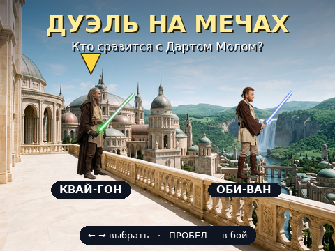
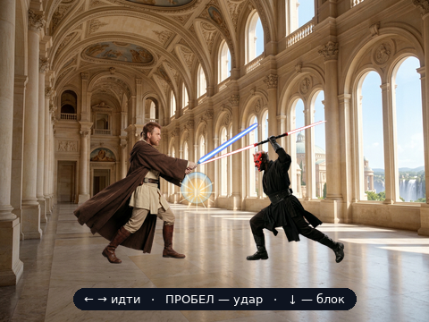
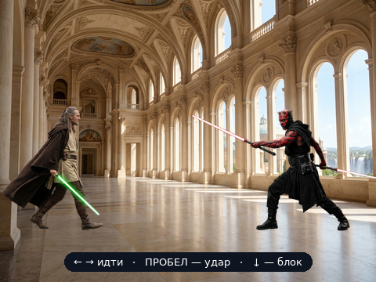
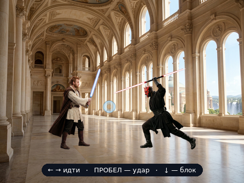
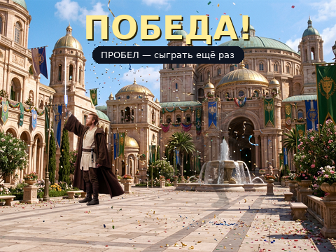

# STAR WARS: Дуэль на Набу — спрайты и фоны для Scratch 3.0

Кинематографичный набор для игры по «Эпизоду I»: фотореалистичные персонажи и корабли,
фоны Набу, световые мечи, звуки и собранный проект **`star_wars_duel.sb3`**,
который открывается в Scratch 3 и сразу играется.


| Уровень 1 — погоня над Набу | Уровень 2 — дуэль в генераторной |
|---|---|
|  |  |

> **Три проекта на выбор:**
> `star_wars_duel.sb3` — полная игра, кинематографичная графика (фотореалистичные PNG);
> `star_wars_duel_lite.sb3` — «Дуэль на мечах»: только бой, простая программа для ребёнка;
> `star_wars_duel_vector.sb3` — полностью векторная графика (SVG, «мультяшная»).

---

## Быстрый старт

**Вариант 1 — играть сразу.** [scratch.mit.edu/projects/editor](https://scratch.mit.edu/projects/editor/)
→ **Файл → Загрузить с компьютера** → `star_wars_duel.sb3`. Зелёный флажок, затем ПРОБЕЛ.

**Вариант 2 — брать только картинки.** Спрайты — `assets/film/sprites/<имя>/` (PNG с альфой),
фоны — `assets/film/backdrops/`, векторные эффекты — `assets/sprites/` (SVG).

**Вариант 3 — для ребёнка.** Возьмите `star_wars_duel_lite.sb3`: там только дуэль
на мечах и совсем короткие скрипты.

**Вариант 4 — собрать самому.** Инструкция со всеми скриптами:
[`docs/СБОРКА_В_SCRATCH.md`](docs/СБОРКА_В_SCRATCH.md). Сюжет и правила:
[`docs/СЮЖЕТ.md`](docs/СЮЖЕТ.md).

---

## Лёгкая версия — «Дуэль на мечах»



Отдельный файл `star_wars_duel_lite.sb3` — только дуэль, без полётов.

- на титуле выбираешь героя: **Квай-Гон** или **Оби-Ван** (← → и ПРОБЕЛ);
- **← →** — идти: герой переступает ногами (костюмы **шаг-1** и **шаг-2**);
- **ПРОБЕЛ** — удар: меч идёт по дуге через промежуточные кадры
  (**замах → переход-2 → атака → переход-3**), без резкой смены позы;
- **↓** — блок: пока держишь, удары Мола не проходят (блок работает даже
  во время собственного замаха);
- у героя 3 жизни, у Мола 4: он подходит, бьёт сериями из двух ударов и успевает
  закрываться, так что «жать ПРОБЕЛ без остановки» не выйдет;
- костюмы: у героев **11** — стойка, шаг-1, шаг-2, замах, атака, переход-1…3,
  блок, ранен, победа; у Мола **10** (без «победы»);
- эффекты: жёлтая **вспышка** в точке удара, синее **кольцо** на блоке,
  **искры** при парировании, позы «ранен» и «победа»;
- фоны светлые — солнечный зал дворца Тид, а не тёмная генераторная;
- **победитель не умирает**: когда у Мола кончаются жизни, герой встаёт
  в позу «победа» с поднятым мечом, а растворяется только Мол;
- **Квай-Гон не погибает по сценарию**: ранения из большой версии здесь нет,
  он теряет жизни только от ударов, как и любой другой герой.

Внутри 7 спрайтов и 524 блока: одна петля на героя, «если» и переменные —
без клонов и списков. Правила и разбор скриптов: [`docs/ДУЭЛЬ_НА_МЕЧАХ.md`](docs/ДУЭЛЬ_НА_МЕЧАХ.md).

| Выбор героя | Удар | Ходьба |
|---|---|---|
|  |  |  |

| Блок | Победа |
|---|---|
|  |  |

---

## Сюжет в двух словах

1. **Уровень 1 — «Погоня над Набу».** Истребитель N-1 прорывается сквозь строй
   дроидов-истребителей: ← → манёвр, ПРОБЕЛ — огонь. Сбей 8 дроидов (80 очков).
2. **Посадка на Набу.** Короткая пауза между уровнями — кадр с террасой дворца Тид.

3. **Уровень 2 — «Генераторная».** Квай-Гон вынужден отступить, и Оби-Ван остаётся
   один против Дарта Мола: ← → бег, ↑ прыжок, ПРОБЕЛ удар, ↓ блок. Три попадания — победа.

---

## Что внутри

### Персонажи (PNG с прозрачностью, ~455 px по высоте)
| Спрайт | Костюмы | Меч | Узнаваемые детали |
|---|---|---|---|
| **Квай-Гон** `assets/film/sprites/quigon/` | стойка, атака | зелёный | длинные волосы с хвостом, борода, песочная туника и тяжёлый коричневый плащ |
| **Оби-Ван** `assets/film/sprites/obiwan/` | стойка, атака | синий | стрижка с прядью, косичка падавана, кремовая туника, бородка |
| **Дарт Мол** `assets/film/sprites/maul/` | стойка, атака | красный, двуклинковый | красная кожа с чёрными татуировками, рога, жёлтые глаза, чёрная мантия |

### Корабли
| Спрайт | Размер | Костюмы |
|---|---|---|
| Истребитель N-1 | 296×300 | двигатель-1…3 (кадры пламени) |
| Дроид-истребитель | 476×260 | крылья-открыты |

### Фоны (480×360, все кинематографичные)
| Файл | Имя в Scratch | Что на кадре |
|---|---|---|
| `assets/film/backdrops/title.png` | Титул | космос и логотип «STAR WARS / NABOO DUEL» |
| `assets/film/backdrops/space.png` | Космос | орбита Набу, планета в облаках |
| `assets/film/backdrops/naboo.png` | Посадка на Набу | терраса дворца Тид, закат, водопады |
| `assets/film/backdrops/generator.png` | Генераторная | зал плазменного реактора, мостки, синее свечение |
| `assets/film/backdrops/victory.png` | Победа | дворец Тид в закатном свете, конфетти в воздухе |

### Эффекты и звуки
`взрыв` — кинематографичный: 4 кадра вспышки, вырезанные из кадра на чёрном фоне
(`assets/film/sprites/explosion/`, свечение сохранено в альфе).
`лазер`, `лазер врага`, `искры`, `плазма-врата` — векторные, лёгкие, в `assets/sprites/`.
Звуки в `assets/sounds/`: лазер, меч вкл/выкл, удар меча, взрыв, гудение, победа, поражение.

---

## Управление

| Экран | Клавиши | Действие |
|---|---|---|
| Титул / финал | ПРОБЕЛ | начать игру или начать заново |
| Уровень 1 | ← → | маневрировать |
| Уровень 1 | ПРОБЕЛ | огонь (+10 очков за дроида) |
| Уровень 2 | ← → или A D | бежать |
| Уровень 2 | ↑ или W | прыжок |
| Уровень 2 | ПРОБЕЛ | удар световым мечом |
| Уровень 2 | ↓ или S | блок |
| «Дуэль на мечах» | ← → | выбрать героя (на титуле) / идти (в бою) |
| «Дуэль на мечах» | ПРОБЕЛ | удар мечом (на титуле — начать бой) |
| «Дуэль на мечах» | ↓ | блок |

---

## Галерея

```bash
python3 tools/serve.py 8000     # затем открыть http://localhost:8000/
```

`preview/index.html` — все персонажи, корабли, фоны и эффекты с превью.

---

## Как это сделано

- **Персонажи и корабли**: сгенерированы в киностиле на ровном хромакее (пурпурный),
  затем вырезаны, деспиллены и выровнены по стопам в общий холст (`tools/film_assets.py`,
  `tools/cutout.py`). Именно выравнивание не даёт спрайту «прыгать» при смене позы.
- **Фоны**: кинематографичные кадры кропятся в 4:3 и приводятся к 480×360.
- **Векторная версия**: полностью нарисована кодом (`tools/rig.py`, `vehicles.py`,
  `backdrops.py`) — легко менять палитру и позы.
- **Проект**: `tools/build_sb3.py` собирает `project.json` и упаковывает `.sb3`,
  `tools/validate_sb3.py` проверяет структуру, `tools/build_sb3_vector.py` — векторную версию.

```bash
python3 tools/gen_assets.py        # векторные ассеты
python3 tools/gen_sounds.py        # звуки
python3 tools/film_assets.py       # вырезка и выравнивание кино-спрайтов
python3 tools/film_title.py        # титульный фон
python3 tools/build_sb3.py         # кино-версия проекта
python3 tools/lite_assets.py       # ассеты лёгкой версии
python3 tools/build_sb3_lite.py    # лёгкая версия проекта
python3 tools/build_sb3_vector.py  # векторная версия проекта
```

---

## Структура репозитория

```
star_wars_duel.sb3          кинематографичная версия игры (2 уровня)
star_wars_duel_lite.sb3     «Дуэль на мечах» — только бой, простая программа
star_wars_duel_vector.sb3   полностью векторная версия
assets/film/                кино-спрайты (PNG), фоны, manifest.json
assets/lite/                лёгкая версия: 11/10 костюмов на героя и Мола, светлые фоны
assets/raw/                 исходные сгенерированные кадры (хромакей, 1400×768)
assets/sprites/, backdrops/ векторные ассеты (SVG) и эффекты
assets/sounds/              синтезированные WAV
preview/                    галерея, постер, скриншоты, PNG-превью
docs/                       сюжет и пошаговая сборка скриптов
tools/                      генераторы ассетов и сборщики проекта
```

---

## Примечание

Неофициальный учебный набор по мотивам фильма «Звёздные войны. Эпизод I: Скрытая угроза».
Персонажи — стилизованные изображения, созданные для детских проектов в Scratch.
Используйте для уроков, кружков и личных проектов.
