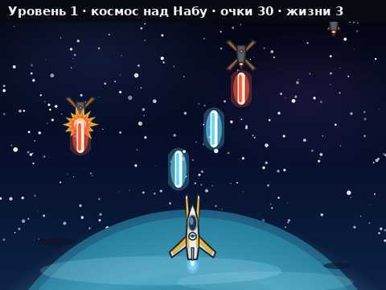
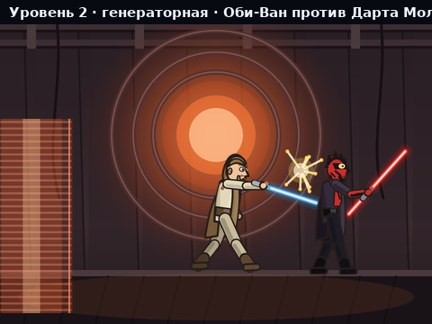

# STAR WARS: Дуэль на Набу — спрайты и фоны для Scratch 3.0

Готовый набор вектора для игры по «Эпизоду I»: **5 фонов**, **11 спрайтов**, **46 костюмов**,
**9 звуков** и собранный проект **`star_wars_duel.sb3`**, который открывается в Scratch 3
и сразу играется.


*Квай-Гон · Оби-Ван · Дарт Мол · истребитель N-1 · дроид-истребитель · Набу*

| Уровень 1 — погоня над Набу | Уровень 2 — дуэль в генераторной |
|---|---|
|  |  |

---

## Быстрый старт

**Вариант 1 — играть сразу.** Откройте [scratch.mit.edu/projects/editor](https://scratch.mit.edu/projects/editor/)
→ **Файл → Загрузить с компьютера** → `star_wars_duel.sb3`. Нажмите зелёный флажок, затем ПРОБЕЛ.

**Вариант 2 — брать только картинки.** Фоны лежат в `assets/backdrops/`, спрайты —
в `assets/sprites/<имя>/`, всё в SVG (родной формат Scratch 3, не мылится при масштабе).
Растровые копии для просмотра — в `preview/png/`.

**Вариант 3 — собрать самому.** Пошаговая инструкция со всеми скриптами:
[`docs/СБОРКА_В_SCRATCH.md`](docs/СБОРКА_В_SCRATCH.md). Сюжет и правила:
[`docs/СЮЖЕТ.md`](docs/СЮЖЕТ.md).

---

## Сюжет в двух словах

1. **Уровень 1 — «Погоня над Набу».** Истребитель N-1 прорывается сквозь строй
   дроидов-истребителей: ← → манёвр, ПРОБЕЛ — огонь. Сбей 8 дроидов (80 очков).
2. **Уровень 2 — «Генераторная».** Квай-Гон вынужден отступить, и Оби-Ван остаётся
   один против Дарта Мола: ← → бег, ↑ прыжок, ПРОБЕЛ удар, ↓ блок. Три попадания — победа.

Подробности — в [`docs/СЮЖЕТ.md`](docs/СЮЖЕТ.md).

---

## Что внутри

### Фоны (480×360)
| Файл | Имя в Scratch | Где используется |
|---|---|---|
| `01-title.svg` | Титул | титульный экран, «THE END» подложка при поражении |
| `02-space.svg` | Космос | уровень 1 |
| `03-naboo.svg` | Посадка на Набу | интерлюдия |
| `04-generator.svg` | Генераторная | уровень 2 (реактор, мостки) |
| `05-victory.svg` | Победа | финал |

### Персонажи (300×230, вид в профиль, лицом вправо)
| Спрайт | Костюмы | Меч | Узнаваемые детали |
|---|---|---|---|
| **Квай-Гон** `sprites/quigon/` | стойка, шаг-1…4, прыжок, удар-1, удар-2, блок, ранен | зелёный | длинные волосы с хвостом, борода, песочная туника и коричневый плащ |
| **Оби-Ван** `sprites/obiwan/` | те же имена | синий | стрижка с прядью, косичка падавана, кремовая туника, бородка |
| **Дарт Мол** `sprites/maul/` | те же имена | красный, двуклинковый | красная кожа с чёрными татуировками, рога, жёлтые глаза, чёрная мантия |

### Техника и эффекты
| Спрайт | Размер | Костюмы |
|---|---|---|
| Истребитель N-1 | 140×200 | двигатель-1…3 (анимация пламени) |
| Дроид-истребитель | 130×130 | крылья-открыты / крылья-сложены |
| Лазер | 26×56 | синий |
| Лазер врага | 26×50 | красный |
| Взрыв | 110×110 | кадр-1…4 |
| Искры (удар мечей) | 90×90 | кадр-1, кадр-2 |
| Плазма-врата | 200×360 | закрыто / открыто |

### Звуки (`assets/sounds/`, WAV 44,1 кГц)
`лазер`, `лазер-врага`, `меч-вкл`, `меч-выкл`, `удар-меча`, `взрыв`, `гудение-меча`,
`победа`, `поражение` — синтезированы специально для набора, без чужой музыки.

---

## Управление в готовом проекте

| Экран | Клавиши | Действие |
|---|---|---|
| Титул / финал | ПРОБЕЛ | начать игру или начать заново |
| Уровень 1 | ← → | маневрировать |
| Уровень 1 | ПРОБЕЛ | огонь (+10 очков за дроида) |
| Уровень 2 | ← → или A D | бежать |
| Уровень 2 | ↑ или W | прыжок |
| Уровень 2 | ПРОБЕЛ | удар световым мечом |
| Уровень 2 | ↓ или S | блок |

---

## Смотреть галерею

В репозитории есть страница со всеми костюмами и фонами:

```bash
python3 tools/serve.py 8000     # затем открыть http://localhost:8000/
```

(Галерея — `preview/index.html`, картинки — `preview/png/`.)

---

## Как это сделано (и как переделать)

Все ассеты **сгенерированы кодом**, поэтому их легко менять и дополнять:

```
tools/
  rig.py           «риг» персонажа: скелет, позы, голова, борода, меч
  vehicles.py      истребители, дроид, лазеры, взрывы, врата
  backdrops.py     пять фонов + мини-шрифт для заголовков
  gen_assets.py    собирает все SVG и manifest.json
  gen_sounds.py    синтез WAV
  build_sb3.py     собирает project.json и упаковывает .sb3
  validate_sb3.py  проверка структуры проекта
  make_gallery.py  генерирует preview/index.html
  make_poster.py   постер
  render_all.js    рендер SVG → PNG (нужен @resvg/resvg-js)
```

Пересобрать всё:

```bash
python3 tools/gen_assets.py && python3 tools/gen_sounds.py && python3 tools/build_sb3.py
python3 tools/make_gallery.py && python3 tools/make_poster.py
```

Хотите другой цвет меча или плаща? Поменяйте палитру в `tools/rig.py`
(`QUIGON`, `OBIWAN`, `MAUL`) и пересоберите — все 10 костюмов перерисуются согласованно.

---

## Структура репозитория

```
star_wars_duel.sb3     готовый проект Scratch 3.0
assets/                фоны, спрайты (SVG), звуки, manifest.json
preview/               галерея, постер и PNG-копии ассетов
docs/СЮЖЕТ.md          сценарий, персонажи, механики, идеи развития
docs/СБОРКА_В_SCRATCH.md  пошаговая сборка скриптов
tools/                 генераторы ассетов и сборщик проекта
```

---

## Примечание

Это неофициальный учебный набор по мотивам фильма «Звёздные войны. Эпизод I: Скрытая
угроза». Персонажи нарисованы с нуля как стилизованная векторная графика для детских
проектов в Scratch; правообладателям не принадлежит ничего из этого репозитория.
Используйте для уроков, кружков и личных проектов.
