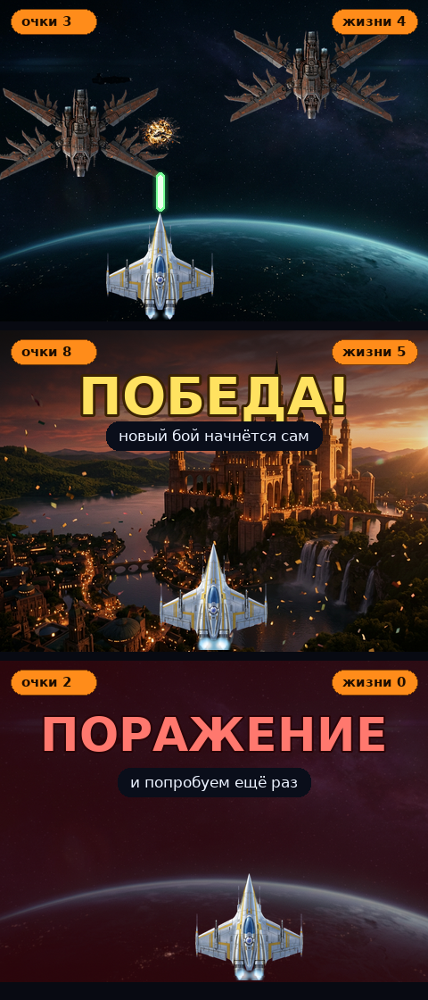

# «Сбей дроидов» — аркада на 100 блоков

Отдельный проект **`star_wars_arcade.sb3`**: самая короткая игра набора.
Корабль Набу внизу экрана, сверху пикируют дроиды-стервятники.



---

## Правила

1. **Полёт.** Держи ← или → — корабль летит над поверхностью Набу.
   У края экрана он мягко отталкивается, поэтому потерять корабль нельзя.
2. **Выстрел.** ПРОБЕЛ — вверх уходит зелёный болт. Пока он в воздухе,
   новый не вылетит: один выстрел за раз.
3. **Дроид сбит.** Болт коснулся дроида — вспыхивает взрыв, `очки` +1.
4. **Дроид прорвался.** Дроид ушёл за нижний край — `жизни` −1.
5. **Финал.** 8 сбитых дроидов — «Победа», 5 пропущенных — «Поражение».
   Через пару секунд экран сам сменяется новым боем.

Всё это — **ровно 100 блоков** (85 на экране редактора плюс 15 скрытых
блоков-меню, которые Scratch не показывает). Никаких списков, клонов-клонов
и сложных условий: только переменные, «повторять пока» и клоны.

---

## Что в проекте

| Спрайт | Костюмы | Что делает |
|---|---|---|
| **Корабль** | двигатель-1…3 | летит по ← →, стреляет по ПРОБЕЛ, отскакивает от края |
| **Лазер** | болт | клон летит вверх, пока не выйдет за край |
| **Дроид** | дроид, взрыв-1…3 | клоны падают сверху; попал — взрыв, пропустил — минус жизнь |
| **Stage** | Космос · Победа · Поражение | старт, экран финала, новый кон |

Переменные: `очки`, `жизни`, `игра`, `лазер`.

| Переменная | Зачем |
|---|---|
| `очки` | сколько дроидов сбито (победа на 8) |
| `жизни` | сколько пропущено (старт с 5) |
| `игра` | 1 — бой идёт, 0 — экран финала |
| `лазер` | 1, пока болт летит: не даёт стрелять очередью |

Скорости в сборщике: шаг корабля 8, дроид опускается на 2.5, болт летит на 14,
новый дроид появляется раз в 1.1 с. Корабль и дроиды — готовые кинокадры
из `assets/film`, лазер и фоны финала рисует `tools/arcade_assets.py`.

---

## Как устроены скрипты

Их всего пять — по одному на «роль», каждый целиком видно в редакторе.

**Сцена** — три коротких:

```
когда нажат флажок
  передать «играть»

когда я получу «играть»
  очки = 0, жизни = 5, игра = 1
  сменить фон на «Космос»

когда я получу «конец»
  игра = 0
  если жизни < 1 → фон «Поражение», звук поражения
  иначе          → фон «Победа», звук победы
  ждать 2.2 сек
  игра = 1
  передать «играть»
```

> `игра = 1` ставится **до** сигнала «играть»: иначе корабль и дроиды успевают
> увидеть «игра = 0» и сразу завершают свои скрипты — новый кон не начинается.

**Корабль** — полёт и выстрел:

```
когда я получу «играть»
  повторять пока игра = 1
     если ← нажата → x −8
     если → нажата → x +8
     если ПРОБЕЛ нажата и лазер = 0
        создать клон «Лазер»
        играть звук «лазер»
     если на краю, оттолкнуться     ← корабль не улетает за экран
```

**Лазер** — один короткий скрипт клона:

```
когда я начинаю как клон
  лазер = 1
  перейти в «Корабль»
  показаться
  повторять пока y > 175
     y +14
  лазер = 0
  удалить этот клон
```

**Дроид** — рождение и падение:

```
когда я получу «играть»                    ← «фабрика» дроидов
  повторять пока игра = 1
     ждать 1.1 сек
     создать клон «Дроид»

когда я начинаю как клон
  перейти в x (случайное −190…190), y 185
  показаться
  повторять пока игра = 0 или y < −140 или касается «Лазер»
     y −2.5
  если касается «Лазер»
     следующий костюм (взрыв), звук, ждать 0.12
     очки +1; если очки > 7 → передать «конец»
  иначе если y < −140
     жизни −1; если жизни < 1 → передать «конец»
  удалить этот клон
```

Попадание считает сам дроид: болт дрон не удаляет, поэтому «касается»
не пропадает между кадрами.

---

## Пересобрать и проверить

```bash
python3 tools/arcade_assets.py       # лазер + фоны «Победа»/«Поражение» → assets/arcade
python3 tools/build_sb3_arcade.py    # → star_wars_arcade.sb3 (проверит, что блоков ≤ 100)
python3 tools/validate_sb3.py star_wars_arcade.sb3
python3 tools/mock_arcade.py         # скриншоты для галереи
```

Прогон в настоящем движке Scratch без браузера (нужны `scratch-vm`, `jsdom`):

```bash
cd /tmp/sbtest && NODE_PATH=/tmp/sbtest/node_modules \
  node /home/user/Star_Wars/tools/vm_test/run_arcade.js \
  /home/user/Star_Wars/star_wars_arcade.sb3
```

Скрипт сам ведёт корабль за дроидами, стреляет, проверяет рост очков, экран
«Победа», автоматический новый кон и «Поражение» после пропущенных дроидов.
Касания в песочнице считаются по прямоугольникам костюмов
(`enableSimpleCollisions` в `tools/vm_test/vm_env.js`).

---

## Как менять под себя

- **Проще:** `жизни = 7` в скрипте сцены или меньше очков для победы
  (`если очки > 4` в скрипте дроида).
- **Сложнее:** уменьшить `ждать 1.1` (дроиды чаще) или ускорить падение:
  `y −2.5` → `y −4`.
- **Больше выстрелов:** `лазер = 0` можно вообще убрать — тогда ПРОБЕЛ
  стреляет каждый кадр (получится «пулемёт», но клонов будет очень много).
- **Свои картинки:** заменить PNG в `assets/arcade` или `assets/film` и
  пересобрать — имена костюмов в скриптах не изменятся.
- **Живой двигатель:** в скрипт корабля вместо «если на краю, оттолкнуться»
  можно поставить **следующий костюм** — пламя начнёт мигать (блоков станет 85).
  Но тогда корабль сможет улететь за край экрана.
