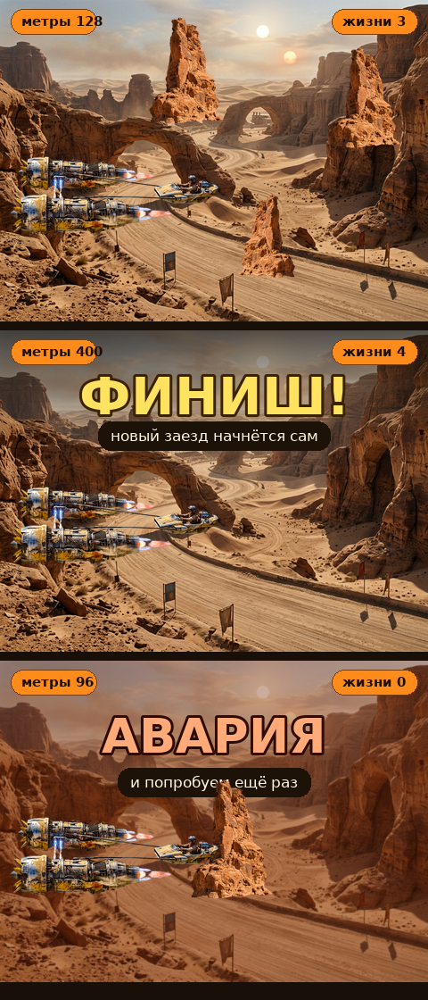

# «Гонки на подах» — гонка по Татуину

Отдельный проект **`star_wars_podrace.sb3`**: под Анакина мчится по пустыне,
сверху и снизу вылетают скалы — надо успеть уйти.



---

## Правила

1. **Полёт.** ↑ — под уходит вверх, ↓ — вниз. Дальше верхнего и нижнего
   края трассы под не выходит.
2. **Скалы.** Справа одна за другой выезжают каменные иглы, пауза между ними
   0.8 секунды. Под ними видно метры: гонка идёт сама, нужно только уклоняться.
3. **Авария.** Столкнулся — вспышка, `жизни` −1. Выдержать можно 4 аварии.
4. **Финиш.** 400 метров — «Финиш!», все жизни кончились — «Авария».
   Через пару секунд экран сам сменяется новым заездом.

Скриптов шесть, блоков — **90** (78 видимых в редакторе плюс 12 скрытых
блоков-меню); лимит в сборщике — 120, так что есть запас на свои идеи.

---

## Что в проекте

| Спрайт | Костюмы | Что делает |
|---|---|---|
| **Под** | под | летит по ↑ ↓, считает метры |
| **Скала** | скала, взрыв-1…3 | клоны едут справа налево, при столкновении взрываются |
| **Stage** | Трасса · Финиш · Авария | старт, финиш, экран аварии |

Переменные: `метры`, `жизни`, `игра`.

| Переменная | Зачем |
|---|---|
| `метры` | сколько пройдено (финиш на 400) |
| `жизни` | сколько аварий ещё выдержит под (старт с 4) |
| `игра` | 1 — заезд идёт, 0 — экран финиша или аварии |

Под и скала — кинокадры, вырезанные с хромакея (`tools/pod_assets.py`),
фон трассы — кадр пустыни 4:3, экраны «Финиш»/«Авария» и рёв двигателя
делает тот же скрипт.

---

## Как устроены скрипты

**Сцена** — три коротких:

```
когда нажат флажок
  передать «играть»

когда я получу «играть»
  метры = 0, жизни = 4, игра = 1
  сменить фон на «Трасса»

когда я получу «конец»
  игра = 0
  если жизни < 1 → фон «Авария», звук поражения
  иначе          → фон «Финиш», звук победы
  ждать 2.2 сек
  игра = 1
  передать «играть»
```

> `игра = 1` ставится **до** сигнала «играть»: иначе под и «фабрика скал»
> успевают увидеть «игра = 0» и сразу завершают свои скрипты.

**Под** — полёт и счётчик метров:

```
когда я получу «играть»
  встать на x −105, y −40
  играть звук «рёв-пода»
  повторять пока игра = 1
     если ↑ нажата → y +10
     если ↓ нажата → y −10
     если y > 100   → y = 100
     если y < −110  → y = −110
     метры +1
     если метры > 399 → передать «конец»
     ждать 0.01
```

**Скала** — «фабрика» и один клон:

```
когда я получу «играть»
  повторять пока игра = 1
     ждать 0.8 сек
     создать клон «Скала»

когда я начинаю как клон
  перейти в x 275, y (случайное −115…115)
  размер (случайное 13…21)%
  если (случайное 0…1) > 0.5 → повернуть на −90°   ← зеркальная скала
  показаться
  повторять пока x < −290 или касается «Под»
     x −8
  если касается «Под»
     размер 55%, следующий костюм (взрыв), звук «взрыв», ждать 0.12
     жизни −1; если жизни < 1 → передать «конец»
  удалить этот клон
```

### Почему в петле пода стоит «ждать 0.01»

В Scratch цикл без движения и без «ждать» крутится не по кадру, а с огромной
скоростью: под без этой строки пролетал все 400 метров за один кадр и игра
заканчивалась мгновенно (нашлось прогоном в scratch-vm). Любая строка
с движением — например `x −8` у скалы — уже заставляет цикл идти по кадру,
поэтому у скалы «ждать» не нужно.

---

## Пересобрать и проверить

```bash
python3 tools/pod_assets.py         # под, скала, 3 фона, рёв-пода.wav → assets/pod
python3 tools/build_sb3_podrace.py  # → star_wars_podrace.sb3 (проверит лимит 120 блоков)
python3 tools/validate_sb3.py star_wars_podrace.sb3
python3 tools/mock_podrace.py       # скриншоты для галереи
```

Прогон в настоящем движке Scratch без браузера:

```bash
cd /tmp/sbtest && NODE_PATH=/tmp/sbtest/node_modules \
  node /home/user/Star_Wars/tools/vm_test/run_podrace.js \
  /home/user/Star_Wars/star_wars_podrace.sb3
```

Проверяется: ↑ ↓ двигают под и он не улетает с трассы, скалы появляются,
столкновение отнимает жизнь, экран «Авария», автоматический новый заезд
и «Финиш» на 400 метрах.

---

## Как менять под себя

- **Легче:** `жизни = 6` в скрипте сцены, больше пауза между скалами
  (`ждать 0.8` → `1.2`) или медленнее скалы (`x −8` → `x −5`).
- **Сложнее:** `ждать 0.5`, скалы быстрее (`x −11`), финиш на 600 метрах
  (`метры > 599`).
- **Длиннее гонка:** в скрипте пода `метры +1` → `метры +0.5` (финиш придёт позже).
- **Свои картинки:** заменить `assets/pod/sprites/pod.png` и
  `assets/pod/sprites/rock.png` и пересобрать — скрипты не изменятся.
