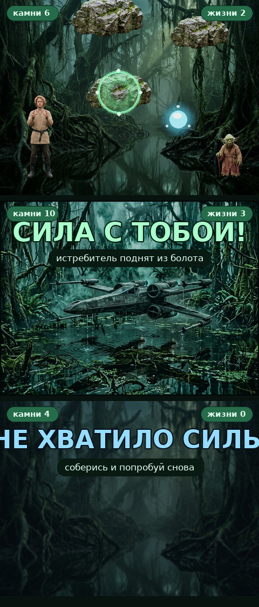

# «Дагоба: тренировка Силы» — камни и кольцо

Отдельный проект **`star_wars_force.sb3`**: на болоте Дагоба Йода учит Люка
поднимать камни Силой. Камни падают сверху — их надо подхватывать кольцом
«Сила», которое летит за курсором мыши.



---

## Правила

1. **Мышь.** Кольцо «Сила» всё время летит за курсором (на планшете — за пальцем).
   Это первая игра набора с управлением мышью: не нужно запоминать клавиши.
2. **Камни.** Каждые ~1.1 секунды сверху падает камень. Подвёл кольцо — камень
   с гулом уходит вверх, `камни` +1. Не успел, камень утонул — `жизни` −1.
3. **Темп растёт.** За каждый пойманный камень камни падают быстрее (на 0.06)
   и появляются чаще (пауза −0.05 с).
4. **Свет Силы.** Раз в 7 секунд мимо проплывает голубая сфера: поймал —
   `жизни` +1. Не поймал — ничего страшного, она просто улетает.
5. **Финиш.** **10 камней** — истребитель поднят из болота, «Сила с тобой!».
   Три утонувших камня — «Не хватило силы». Через пару секунд игра начинается сама.

Блоков — **121** (106 видимых в редакторе плюс 15 скрытых блоков-меню);
лимит, который просил пользователь, — 150, так что есть запас на свои идеи.

---

## Что в проекте

| Спрайт | Костюмы | Что делает |
|---|---|---|
| **Люк** | Люк | стоит в воде и держит Силу |
| **Йода** | Йода | подсказывает и подбадривает вслух |
| **Сила** | Сила | кольцо, летит за курсором |
| **Камень** | камень | клоны падают сверху |
| **Свет** | Свет | клоны плывут сверху, +1 жизнь |
| **Stage** | Болото · Победа · Провал | старт, победа, провал |

Переменные: `камни`, `жизни`, `игра`, `падение`, `пауза`.

| Переменная | Зачем |
|---|---|
| `камни` | сколько камней поднято (победа на 10) |
| `жизни` | сколько камней ещё можно уронить (старт с 3) |
| `игра` | 1 — тренировка идёт, 0 — экран финала |
| `падение` | с какой скоростью падают камни (сначала −3, потом быстрее) |
| `пауза` | сколько ждать между камнями (сначала 1.1 с, потом меньше) |

---

## Как устроены скрипты

**Сцена** — три коротких:

```
когда нажат флажок
  передать «играть»

когда я получу «играть»
  камни = 0, жизни = 3, падение = −3, пауза = 1.1, игра = 1
  сменить фон на «Болото»

когда я получу «конец»
  игра = 0
  если жизни < 1 → фон «Провал», звук поражения
  иначе          → фон «Победа», звук победы
  ждать 2.5 сек
  игра = 1
  передать «играть»
```

**Сила** — самая короткая программа в наборе:

```
когда я получу «играть»
  перейти на передний план
  повторять пока игра = 1
     перейти в «указатель мыши»
     ждать 0.01
```

**Камень** — «фабрика» и клон:

```
когда я получу «играть»
  повторять пока игра = 1
     ждать (пауза)
     создать клон «Камень»

когда я начинаю как клон
  перейти в x (случайное −215…215), y 190
  размер (случайное 75…115)%
  показаться
  повторять пока y < −145 или касается «Сила»
     y = y + (падение)
  если касается «Сила»
     звук «сила»
     повторить 8: y +9            ← камень уходит вверх
     камни +1
     падение −0.06, пауза −0.05   ← темп растёт
     если камни > 9 → передать «конец»
  иначе
     звук «всплеск», жизни −1
     если жизни < 1 → передать «конец»
  удалить этот клон
```

**Свет** — то же самое, но наоборот: `касается «Сила»` → звук «блип» и `жизни +1`.

**Йода** — три реплики: подсказка на старте, похвала после пятого камня,
предупреждение, когда остаётся одна жизнь, и итог на экране финала.

---

## Пересобрать и проверить

```bash
python3 tools/force_assets.py        # Люк, Йода, камни, кольцо → assets/force
python3 tools/build_sb3_force.py     # → star_wars_force.sb3 (проверит лимит 150 блоков)
python3 tools/validate_sb3.py star_wars_force.sb3
python3 tools/mock_force.py          # скриншоты для галереи
```

Прогон в настоящем движке Scratch без браузера (мышь двигаем прямо в VM):

```bash
cd /tmp/sbtest && NODE_PATH=/tmp/sbtest/node_modules \
  node /home/user/Star_Wars/tools/vm_test/run_force.js \
  /home/user/Star_Wars/star_wars_force.sb3
```

Проверяется: кольцо летит за курсором, камень ловится и счёт растёт, темп
ускоряется, утонувший камень отнимает жизнь, «свет Силы» прибавляет жизнь,
десятый камень даёт «Победа», последняя жизнь — «Провал», игра начинается заново.

---

## Как менять под себя

- **Легче:** `жизни = 5` в стартовом скрипте сцены; больше пауза
  (`пауза = 2` вместо 1.1); медленнее камни (`падение = −2`).
- **Сложнее:** `пауза = 0.8`, `падение = −4`, победа на 15 камнях
  (`камни > 14`).
- **Кольцо больше:** в спрайтах увеличить размер «Силы» до 130 %.
- **Свои картинки:** заменить файлы в `assets/force/sprites/` и пересобрать —
  скрипты не изменятся.

---

## Заметка для разработчика

Пока собирал игру, нашёл в `tools/sb3lib.py` ошибку: `wait(...)` всегда
превращал аргумент в число, и если в «ждать» подставить переменную
(`ждать (пауза)`), в проект уезжала строка `"('rep', ...)"` — Scratch читал её
как 0 и камни сыпались по десять штук в секунду. Теперь `wait` и `repeat`
принимают и число, и блок-переменную: прогон в VM это сразу поймал бы,
в браузере выглядело бы как «слишком сложно, невозможно играть».
