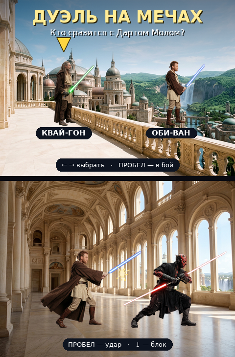

# «Дуэль на мечах» — лёгкая версия игры

Отдельный проект **`star_wars_duel_lite.sb3`**: только бой на световых мечах,
без полётов и второго уровня. Сделан так, чтобы ребёнок 7–10 лет понял игру
с первого экрана, а при желании — разобрал и переделал скрипты.



---

## Правила

1. **Выбор героя.** На титуле стоят Квай-Гон и Оби-Ван. Стрелки ← → двигают
   жёлтую стрелку, ПРОБЕЛ — начать бой.
2. **Удар.** ПРОБЕЛ — герой встаёт в позу «атака» и снимает у Мола одну жизнь.
3. **Блок.** Держи ↓ — герой встаёт в позу «блок», и удар Мола не отнимает жизнь.
4. **Жизни.** У героя и у Мола по 3. Кто первый потеряет все — тот проиграл.
5. **Конец.** Победа или поражение, затем ПРОБЕЛ — и всё начинается снова.

> **Квай-Гон не погибает по сценарию.** В большой версии он был ранен и уступал
> бой Оби-Вану — здесь такого скрипта нет вообще: герой теряет жизни только от
> ударов Мола, как и все остальные. Выбрал Квай-Гона — им и дерёшься до конца.

---

## Что в проекте

| Спрайт | Костюмы | Что делает |
|---|---|---|
| **Квай-Гон** | стойка, атака, блок | играет, если выбран первым |
| **Оби-Ван** | стойка, атака, блок | играет, если выбран вторым |
| **Дарт Мол** | стойка, атака, блок | закрывается, замахивается, бьёт |
| **Стрелка** | стрелка | показывает выбранного героя |
| **Искры** | кадр-1, кадр-2 | вспышка в точке встречи клинков |
| **Сцена** | Выбор героя · Дуэль · Победа · Поражение | четыре светлых фона |

Переменные: `выбор`, `хп_героя`, `хп_мола`, `блок`, `мол_бьёт`, `игра` — шесть,
все с понятными названиями, поэтому в редакторе сразу видно, что происходит.

---

## Как устроены скрипты

Вся игра — это три коротких кусочка:

**Сцена** — выбор героя и запуск боя:

```
когда нажат флажок
  установить игра = 0, выбор = 1
  сменить фон на «Выбор героя»

когда я получу «выбор»
  установить хп_героя = 3, хп_мола = 3, игра = 0
  повторять пока игра = 0
     если ← нажата → выбор = 1
     если → нажата → выбор = 2
     если ПРОБЕЛ нажата → игра = 1, фон «Дуэль», передать «бой»
```

**Герой** — одна петля:

```
когда я получу «бой»
  если выбор = мой номер
     повторять пока игра = 1
        если ↓ нажата → блок = 1, костюм «блок»
        если ПРОБЕЛ и блок = 0 → костюм «атака», хп_мола −1, искры
        иначе → блок = 0, костюм «стойка»
```

**Дарт Мол** — ритм: закрылся → замахнулся → ударил:

```
повторять пока игра = 1
  костюм «блок», ждать 0.9
  костюм «атака», мол_бьёт = 1, ждать 0.25
  если блок = 0 → хп_героя −1
  костюм «стойка», мол_бьёт = 0, ждать 0.5
  если хп_героя < 1 → поражение
  если хп_мола < 1 → победа
```

Никаких клонов, списков и вложенных условий — только «если», «повторять пока»
и переменные. Всего 294 блока на 5 спрайтов.

---

## Пересобрать проект

```bash
python3 tools/lite_assets.py     # костюмы «блок» + светлые фоны → assets/lite
python3 tools/build_sb3_lite.py  # → star_wars_duel_lite.sb3
python3 tools/validate_sb3.py star_wars_duel_lite.sb3
python3 tools/mock_lite.py       # скриншоты для галереи
```

Костюмы «стойка» и «атака» берутся из большой версии (`assets/film`), поэтому
персонажи выглядят одинаково в обеих играх. Поза «блок» вырезана с хромакея и
вписана в тот же холст, что и остальные костюмы: рост фигуры и линия стоп
совпадают, поэтому при смене костюма спрайт не прыгает.

---

## Как менять под себя

- **Сложнее:** в скрипте Мола уменьшить `ждать 0.9` → он бьёт чаще.
- **Легче:** поставить герою `хп_героя = 5`.
- **Быстрее:** уменьшить `ждать 0.30` после удара героя.
- **Новый герой:** скопировать спрайт, добавить в переменную `выбор` третий номер.
