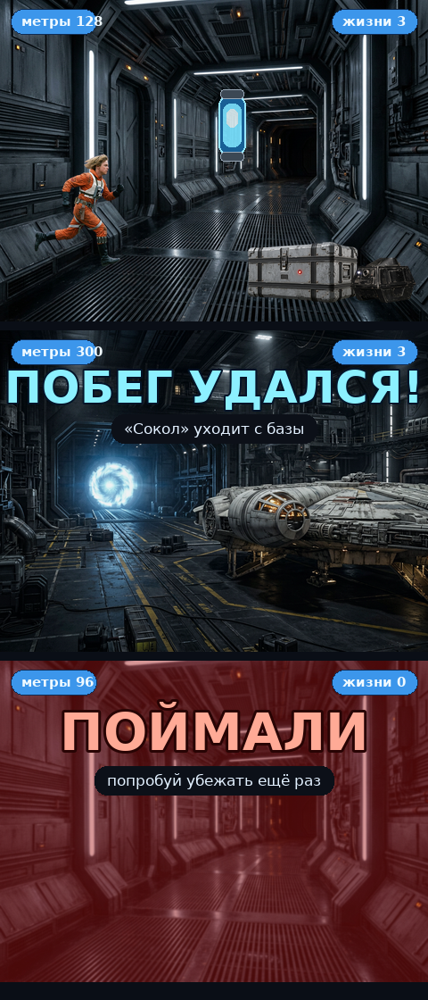

# «Побег со „Звезды Смерти“» — бег с прыжком

Отдельный проект **`star_wars_escape.sb3`**: Люк бежит по коридорам станции
к ангару, где ждёт «Тысячелетний сокол». Навстречу катятся ящики и дроиды —
их надо перепрыгивать, а высоко висят энергоячейки: за ними надо прыгать.



---

## Правила

1. **Прыжок.** **ПРОБЕЛ** (или ↑) — Люк прыгает. Прыжок настоящий: скорость
   взлёта 17, каждый кадр она уменьшается на 1.2, на полу Люк снова на ногах.
2. **Препятствия.** Каждые 1.4 секунды справа выезжает ящик или дроид.
   Не перепрыгнул — `жизни` −1. Выдержать можно 3 удара.
3. **Энергоячейка.** Раз в 3 секунды над коридором проплывает синяя ячейка:
   её достаёт только прыжок. Поймал — `жизни` +1.
4. **Финиш.** 300 метров — «Побег удался!», все жизни кончились — «Поймали».
   Через пару секунд новый забег начинается сам.

Блоков — **113** (97 видимых в редакторе плюс 16 скрытых блоков-меню);
лимит в сборщике — 120.

Управление специально из одной кнопки: ребёнку не надо запоминать раскладку,
всё внимание уходит на момент прыжка.

---

## Что в проекте

| Спрайт | Костюмы | Что делает |
|---|---|---|
| **Люк** | бег-1, бег-2 | бежит по коридору, прыгает, считает метры |
| **Препятствие** | ящик, дроид | клоны едут справа налево |
| **Ячейка** | ячейка | клоны плывут справа налево, +1 жизнь |
| **Stage** | Коридор · Ангар · Поймали | старт, побег, экран поимки |

Переменные: `метры`, `жизни`, `игра`, `прыжок`.

| Переменная | Зачем |
|---|---|
| `метры` | сколько пройдено (побег на 300) |
| `жизни` | сколько ударов ещё выдержит Люк (старт с 3) |
| `игра` | 1 — забег идёт, 0 — экран финала |
| `прыжок` | скорость взлёта: 17 в момент прыжка, потом падает на 1.2 за кадр |

---

## Как устроены скрипты

**Сцена** — три коротких, как в остальных играх набора:

```
когда нажат флажок
  передать «играть»

когда я получу «играть»
  метры = 0, жизни = 3, игра = 1
  сменить фон на «Коридор»

когда я получу «конец»
  игра = 0
  если жизни < 1 → фон «Поймали», звук поражения
  иначе          → фон «Ангар», звук победы
  ждать 2.2 сек
  игра = 1
  передать «играть»
```

**Люк** — бег, прыжок и счётчик:

```
когда я получу «играть»
  встать на x −150, y −96
  повторять пока игра = 1
     если (ПРОБЕЛ или ↑) и y = −96 → прыжок = 17      ← прыжок только с пола
     прыжок = прыжок − 1.2
     y = y + прыжок
     если y < −96 → y = −96, прыжок = 0               ← приземление
     следующий костюм                                 ← две позы бега
     метры +1
     если метры > 299 → передать «конец»
     ждать 0.01
```

> **Почему «ждать 0.01».** Цикл без движения и без «ждать» в Scratch крутится
> не по кадру, а с огромной скоростью: без этой строки Люк пролетал бы все
> 300 метров за один кадр. У препятствий и ячеек движение в цикле уже есть,
> поэтому там «ждать» не нужен.

**Препятствие** — «фабрика» и клон:

```
когда я получу «играть»
  повторять пока игра = 1
     ждать 1.4 сек
     следующий костюм        ← клон получает костюм оригинала:
     создать клон «Препятствие»   ящик и дроид идут по очереди

когда я начинаю как клон
  перейти в x 275, y −125
  показаться
  повторять пока x < −290 или (близко к Люку и Люк низко)
     x −7
  если близко к Люку
     звук «лазер», жизни −1; если жизни < 1 → передать «конец»
  удалить этот клон
```

«Близко» — это блок **«расстояние до Люк» < 72** вместе с проверкой
**«y Люка < −55»**: пока Люк в прыжке, он выше этой черты и столкновения нет.
Такой счёт честнее обычного «касается»: широкая картинка ящика не делает игру
непроходимой, удар считается по центру.

**Ячейка** — то же самое, но наоборот: `касается Люк` → звук «блип» и
`жизни +1`.

---

## Пересобрать и проверить

```bash
python3 tools/escape_assets.py       # Люк, ящик, дроид, ячейка, 3 фона → assets/escape
python3 tools/build_sb3_escape.py    # → star_wars_escape.sb3 (проверит лимит 120 блоков)
python3 tools/validate_sb3.py star_wars_escape.sb3
python3 tools/mock_escape.py         # скриншоты для галереи
```

Прогон в настоящем движке Scratch без браузера:

```bash
cd /tmp/sbtest && NODE_PATH=/tmp/sbtest/node_modules \
  node /home/user/Star_Wars/tools/vm_test/run_escape.js \
  /home/user/Star_Wars/star_wars_escape.sb3
```

Проверяется: прыжок поднимает Люка и возвращает на пол, препятствия выезжают,
прыжок спасает от ящика, ячейка прибавляет жизнь, последняя жизнь даёт
«Поймали», забег начинается заново и 300 метров дают «Ангар».

---

## Как менять под себя

- **Легче:** `жизни = 5` в стартовом скрипте сцены, реже ящики
  (`ждать 1.4` → `ждать 1.8`) или медленнее (`x −7` → `x −5`).
- **Сложнее:** `ждать 0.9`, ящики быстрее (`x −9`), побег на 500 метрах
  (`метры > 499`).
- **Прыжок выше:** `прыжок = 17` заменить на `22`; ниже — на `13`.
- **Длиннее забег:** в скрипте Люка `метры +1` → `метры +0.5`.
- **Свои картинки:** заменить файлы в `assets/escape/sprites/` и пересобрать —
  скрипты не изменятся.

---

## Заметка для разработчика

При сборке нашлись две вещи, которые стоит помнить:

1. В `tools/sb3lib.py` блок «расстояние до» отправлял вход с именем `DISTANCETO`,
   а scratch-vm ждёт `DISTANCETOMENU` — из-за этого расстояние всегда было
   10000 и столкновения не срабатывали. Исправлено в `sb3lib.py`
   и в проверке `validate_sb3.py`.
2. Клон в Scratch получает костюм оригинала в момент создания. На этом и
   построено чередование «ящик → дроид» без единого лишнего блока.
